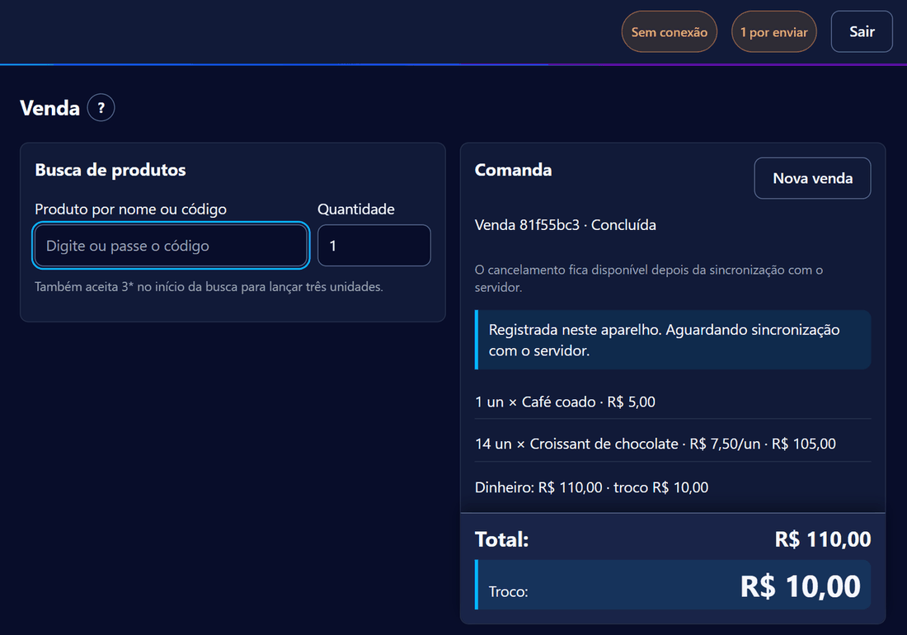
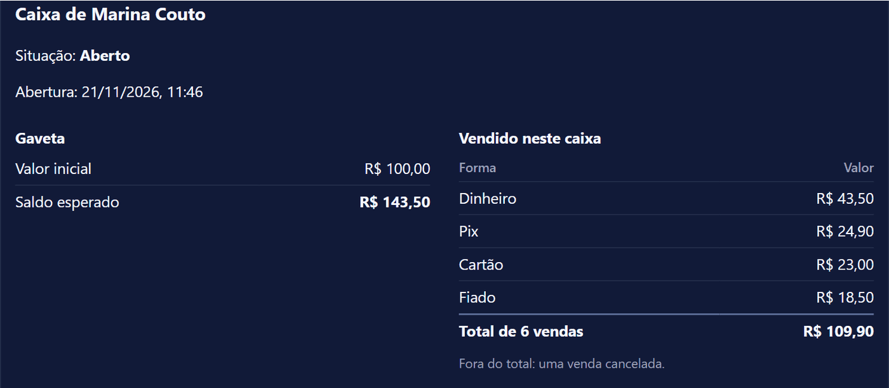
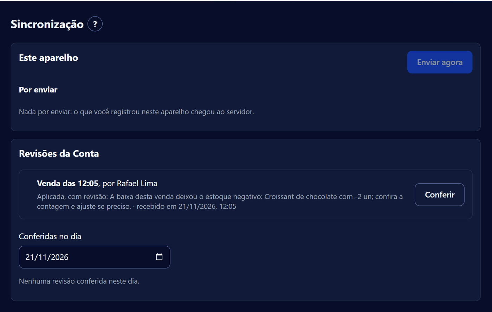
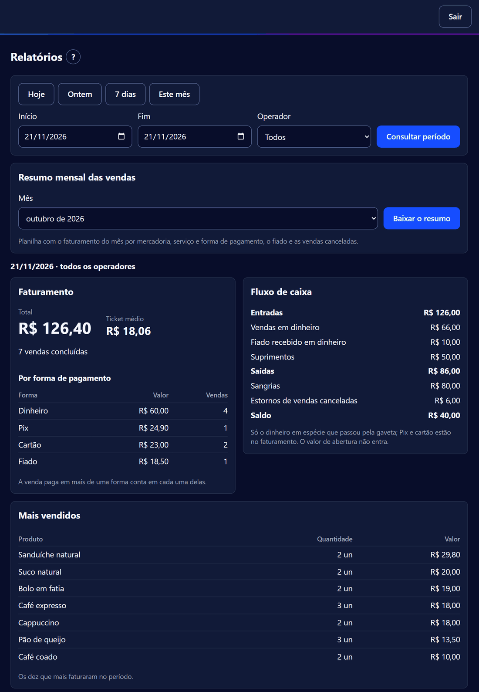
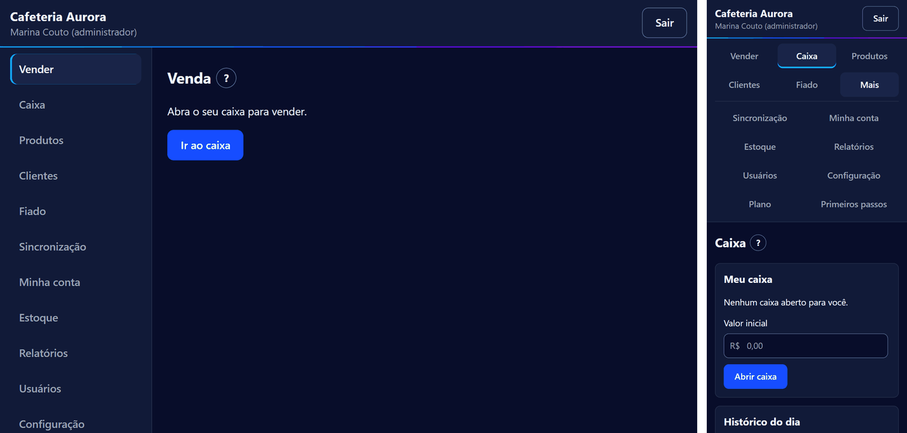
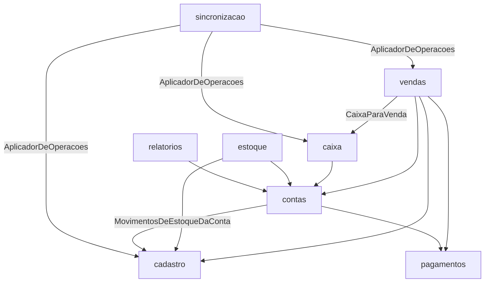
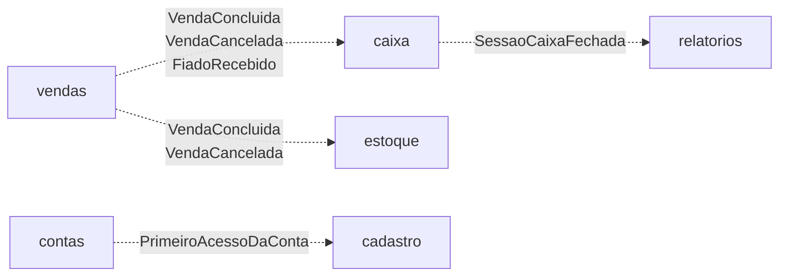

# ECRX Caixa

Sistema de caixa e ponto de venda multi-tenant para pequenos negócios, que continua vendendo sem
internet. Monolito modular em Java com Spring Boot e Spring Modulith, com um PWA em React.

[](https://github.com/Elias-Costa/ecrx-caixa/actions/workflows/ci.yml)


> **Vitrine técnica.** Este repositório existe para que o código possa ser lido e avaliado, não para
> ser distribuído. O que ele traz de implantação (a imagem, a configuração do servidor e os scripts
> de operação) é o ambiente do próprio projeto, versionado junto do código porque faz parte do desenho,
> e não um guia de instalação para terceiros. Ver [Licença](#licença).
>
> O MVP está concluído e no ar. O comprovante é não fiscal: a emissão de nota fiscal ainda não existe
> em código, nem os módulos verticais citados em [Sobre o projeto](#sobre-o-projeto).

<p align="center">
  
  <br>
  <sub>Venda concluída sem internet: o cabeçalho conta o que falta enviar, e a comanda diz que a
  venda espera a sincronização com o servidor.</sub>
</p>

---

## Sumário

- [Sobre o projeto](#sobre-o-projeto)
- [Telas](#telas)
- [O que o sistema faz](#o-que-o-sistema-faz)
- [Por onde começar a leitura](#por-onde-começar-a-leitura)
- [Arquitetura](#arquitetura)
- [Decisões estruturais](#decisões-estruturais)
- [Segurança e isolamento](#segurança-e-isolamento)
- [Modelo de dados](#modelo-de-dados)
- [Qualidade e testes](#qualidade-e-testes)
- [Implantação](#implantação)
- [Stack](#stack)
- [Estrutura do repositório](#estrutura-do-repositório)
- [Autor](#autor)
- [Licença](#licença)

**Documentos de apoio:** [ARQUITETURA.md](ARQUITETURA.md), o desenho e o porquê de cada escolha;
[FUNCIONALIDADES.md](FUNCIONALIDADES.md), cada módulo e cada tela em detalhe; [API.md](API.md), as
rotas HTTP e o que cada uma recusa; e [operacao/README.md](operacao/README.md), a operação do
servidor.

---

## Sobre o projeto

Um mercadinho, uma cafeteria e um salão precisam da mesma coisa: registrar a venda, controlar o
caixa e saber quanto entrou no dia. Cada um, porém, chama os itens de um jeito e guarda atributos
diferentes deles. A saída comum do mercado é um sistema por segmento, ou um sistema genérico que
obriga todo mundo a caber no mesmo cadastro.

Três problemas técnicos definem o desenho deste sistema:

1. **Catálogo genérico sem migração por cliente.** Colunas fixas para o que é universal (nome,
   preço, categoria, unidade) e uma coluna `JSONB` com índice GIN para os atributos que variam por
   tipo de negócio. Sem tabela por segmento e sem EAV.
2. **Operação offline confiável.** Registrar venda, cadastrar item e abrir ou fechar o caixa
   precisam continuar funcionando sem internet. Isso empurra decisões para dentro do modelo:
   identidade gerada no cliente, sincronização idempotente, sessão que resiste à falta de rede.
3. **Isolamento entre contas como requisito de segurança**, não como detalhe de implementação. Dado
   de um negócio nunca pode aparecer para outro, e isso precisa ser provado por teste.

O sistema é um monolito modular preparado para receber módulos verticais (agenda, comanda, ficha de
cliente) sem redesenhar o núcleo.

## Telas

As capturas são de uma conta de demonstração, com dados fictícios.

<p align="center">
  
  <br>
  <sub>O caixa aberto: a gaveta com o saldo esperado, ao lado do vendido em cada forma de pagamento.</sub>
</p>

<p align="center">
  
  <br>
  <sub>A revisão do administrador: a venda feita sem rede foi aplicada, mas deixou o estoque
  negativo, e espera a conferência.</sub>
</p>

<p align="center">
  
  <br>
  <sub>Relatórios do dia: faturamento por forma de pagamento, fluxo de caixa da gaveta e os mais
  vendidos, com o resumo mensal em planilha.</sub>
</p>

<p align="center">
  
  <br>
  <sub>O mesmo aplicativo no computador, com o menu na lateral, e no celular, com o resto no botão Mais.</sub>
</p>

## O que o sistema faz

- **Venda no balcão.** Busca por nome, código ou leitor de código de barras, comanda com desconto
  dado pelo administrador, pagamento dividido entre dinheiro com troco, cartão com o NSU da
  maquininha, Pix e fiado, e comprovante não fiscal para imprimir ou compartilhar.
- **Pix.** O Pix lançado à mão mostra ao cliente um QR estático montado no próprio aparelho. O Pix
  integrado cria a cobrança no provedor, Efí ou Inter, e só quita a parcela depois de reconsultar o
  pagamento (RF25).
- **Caixa.** Abertura, sangria, suprimento e fechamento com o saldo esperado à vista e a diferença
  apurada; histórico por operador e por dia, extrato com quem lançou cada movimento e aviso do caixa
  que ficou aberto desde um dia anterior.
- **Fiado.** Venda fiada para Cliente cadastrado, registrada pelo administrador, com recebimentos
  parciais e comprovante de cada um (RF33).
- **Cadastro.** Produtos e serviços com atributos que variam por tipo de negócio, clientes, e um
  catálogo sugerido copiado no primeiro acesso.
- **Estoque, opcional por Conta.** Baixa pela venda, devolução no cancelamento, entrada de
  mercadoria, ajuste com motivo, mínimo por produto e alerta de estoque baixo.
- **Relatórios.** Faturamento, mais vendidos, fluxo de caixa da gaveta, conferências do cartão e do
  Pix contra os extratos, resumo mensal em planilha (RF67) e o resumo de cada caixa fechado, por
  e-mail, ao administrador.
- **Sem internet.** Venda, caixa e cadastro continuam no aparelho sem rede ou sem resposta do
  servidor. A fila de gestos sai sozinha quando ele volta, cada gesto é aplicado uma vez, e o que
  diverge do servidor vai para a revisão do administrador.
- **Usuários e acesso.** Administrador e operador com login próprio, gestão de usuários, troca de
  senha e saída de todos os aparelhos; a operação do serviço suspende na hora o acesso de uma Conta
  inteira.
- **Plano.** Teste de 14 dias, pagamento por Pix registrado com um código entregue depois da
  conferência, aviso antes do vencimento e só leitura depois da tolerância.
- **Privacidade.** Aviso de privacidade e termos de uso públicos, aceite dos termos por versão,
  remoção dos dados de Cliente e encerramento da Conta, como pede a LGPD.

O comportamento de cada parte, com as regras de borda, está em
[FUNCIONALIDADES.md](FUNCIONALIDADES.md), e as rotas da API, em [API.md](API.md).

## Por onde começar a leitura

Atalhos para avaliar o código sem percorrer o repositório inteiro. O javadoc explica **por que**,
não o que o código já diz.

| O que olhar | Onde | Por que vale a leitura |
|---|---|---|
| Fronteira de módulo verificada por teste | [ModularityTests.java](src/test/java/br/com/caixasimples/ModularityTests.java) | A arquitetura falha o build quando é violada, em vez de depender de disciplina |
| Isolamento entre contas provado nos dois sentidos | [IsolamentoEntreContasTest.java](src/test/java/br/com/caixasimples/contas/IsolamentoEntreContasTest.java) e [MultiTenancyConfiguration.java](src/main/java/br/com/caixasimples/shared/internal/MultiTenancyConfiguration.java) | Grava na conta A e prova que a conta B não enxerga; o filtro é do Hibernate, não de cada consulta |
| Autorização explícita, sem anotação | [UsuarioContext.java](src/main/java/br/com/caixasimples/shared/UsuarioContext.java) | Quem chama vem do contexto, nunca de parâmetro, e cada caso de uso restrito pergunta na primeira linha |
| Invariante viva, recalculada a cada operação | [Venda.java](src/main/java/br/com/caixasimples/vendas/domain/Venda.java) | O total nunca diverge dos itens, a Venda concluída é coberta pelos pagamentos, e o estado lido do banco passa pela mesma conferência |
| Raiz de agregado sem framework | [SessaoCaixa.java](src/main/java/br/com/caixasimples/caixa/domain/SessaoCaixa.java) | Regra de negócio e invariantes isoladas de Spring e de JPA |
| Efeito colateral entre módulos por evento | [VendaConcluidaListener.java](src/main/java/br/com/caixasimples/caixa/internal/VendaConcluidaListener.java) | O caixa reage à venda concluída sem que a venda o conheça, dentro da transação que concluiu |
| Dependência num sentido só | [CaixaParaVenda.java](src/main/java/br/com/caixasimples/vendas/CaixaParaVenda.java) | A pergunta da venda ao caixa é uma interface declarada em vendas e implementada no caixa, porque a verificação de fronteiras recusa ciclo |
| Sincronização idempotente por operação | [SincronizacaoService.java](src/main/java/br/com/caixasimples/sincronizacao/application/SincronizacaoService.java) e [AplicadorDeOperacoes.java](src/main/java/br/com/caixasimples/sincronizacao/AplicadorDeOperacoes.java) | Uma transação por gesto, com o resultado gravado junto: o reenvio devolve o gravado, e o envio simultâneo não aplica duas vezes |
| A fila do aparelho | [envio.ts](frontend/src/offline/envio.ts) e [fila.ts](frontend/src/offline/fila.ts) | Uma rodada de envio por vez entre as abas, e uma projeção local que não conta duas vezes o que o servidor já contém |
| Concorrência reproduzida sem pausa | [CancelamentoERecebimentoSobConcorrenciaTest.java](src/test/java/br/com/caixasimples/vendas/CancelamentoERecebimentoSobConcorrenciaTest.java) | Outra transação segura a linha e só confirma quando o PostgreSQL mostra a espera; a operação é recusada inteira, sem efeito pela metade |
| Strategy sem `switch` | [PaymentService.java](src/main/java/br/com/caixasimples/pagamentos/application/PaymentService.java) | Forma de pagamento nova é classe nova; duas estratégias para a mesma forma derrubam a aplicação na subida |
| Value object monetário | [Money.java](src/main/java/br/com/caixasimples/shared/Money.java) | Arredondamento explícito no ponto de uso, sem `double` e sem construtor que reescreve valor em silêncio |
| Um módulo que só lê, garantido por construção | [VendaParaRelatorio.java](src/main/java/br/com/caixasimples/relatorios/internal/VendaParaRelatorio.java) | A mesma tabela mapeada de novo, imutável e só com o que o relatório usa, sem importar o pacote interno de vendas |
| Vertical slice deliberado | [ClienteService.java](src/main/java/br/com/caixasimples/cadastro/internal/ClienteService.java) | Onde o projeto decide **não** aplicar DDD, porque não há invariante a proteger |

Mais atalhos, por tema, no [guia de leitura do código](ARQUITETURA.md#guia-de-leitura-do-código).

## Arquitetura

**Monolito modular, não microsserviços.** Nove módulos, cada um um Bounded Context do DDD e um
pacote direto abaixo de `br.com.caixasimples`; o pacote e o artefato do Maven guardam o nome de
trabalho do projeto, Caixa Simples. O Spring Modulith verifica as fronteiras em teste: quebrar a
fronteira quebra o build.

| Módulo | Responsabilidade |
|---|---|
| `contas` | Conta, usuários, autenticação por JWT, plano e termos de uso |
| `cadastro` | Produto com atributos em `JSONB`, Cliente, catálogo sugerido e o agregado do estoque |
| `vendas` | O agregado Venda: comanda, pagamentos, fiado, comprovante e Pix |
| `caixa` | A `SessaoCaixa`: abertura, sangria, suprimento e fechamento com conferência |
| `pagamentos` | Strategy por forma de pagamento e um adapter por provedor de Pix |
| `estoque` | A política do estoque: decide a baixa, a devolução, o ajuste e o alerta, e pede ao cadastro |
| `relatorios` | Consultas só de leitura e o resumo do caixa por e-mail |
| `sincronizacao` | Recebe o lote de gestos feitos sem rede e aplica cada um uma vez, pelo módulo dono |
| `shared` | Dinheiro, a conta e o usuário em operação, o tratamento de erro e a entrega do aplicativo |

Um módulo nunca importa de `internal/` de outro. Efeito colateral entre módulos é Domain Event, e
consulta é chamada direta à API pública do pacote: *eventos anunciam fatos, chamadas diretas fazem
perguntas.* Os dois diagramas abaixo saem dos imports do código.

**Chamadas diretas**, de quem chama para quem responde. Quando a seta tem nome, a chamada passa por
uma interface declarada em quem chama e implementada em quem responde, para a dependência de
compilação ficar num sentido só.



**Eventos**, de quem publica para quem ouve. Os ouvintes rodam na transação de quem publica, e por
isso a Venda, o dinheiro na gaveta e a baixa de estoque confirmam juntos. O caixa fechado é a
exceção: chega ao relatório depois do commit, pelo outbox, porque o resumo por e-mail não pode
derrubar o fechamento.



Todos dependem de `shared`, e os diagramas omitem a dependência que só lê um enum de outro módulo;
`relatorios` lê as tabelas dos outros por mapeamentos próprios, só de leitura.

Dentro de cada módulo:

```
<modulo>/
├── domain/        regra de negócio pura, sem Spring e sem Jakarta
├── application/   casos de uso, transação, orquestração
├── web/           controllers REST
└── internal/      JPA, adapters e configuração, invisível aos outros módulos
```

Nem todo módulo tem as quatro: uma camada nasce quando há o que colocar nela. A autorização por
perfil mora em `application/`, como a primeira linha de cada caso de uso restrito, e não em anotação
nem em tabela de rotas.

Padrões em uso, cada um porque havia o problema que ele resolve:

- **Repository** só para raiz de agregado: membro entra e sai pela raiz.
- **Strategy** por forma de pagamento, resolvido por mapa e sem `switch`.
- **Adapter** de Pix atrás de `PixGateway`, um por provedor, escolhido pela configuração da Conta.
- **Value object** para dinheiro, com o arredondamento visível em quem o chama.
- **Domain Events** síncronos entre venda, caixa e estoque, e **outbox** para o e-mail.
- **Dependency inversion** entre módulos onde uma pergunta e um evento cruzariam em sentidos opostos.
- **Modelo de leitura próprio** no módulo que só lê, sem `save` nem `delete`.
- **Vertical slice** onde não há invariante a proteger.
- **Fitness function** de arquitetura, que transforma a regra de fronteira em teste.
- **Idempotência por operação** na sincronização, e **fila local** com UUID por gesto no PWA.

O desenho inteiro, com o porquê de cada regra, está em [ARQUITETURA.md](ARQUITETURA.md#módulos).

## Decisões estruturais

- **Multi-tenancy por coluna.** Toda entidade de negócio tem `contaId` com `@TenantId`, e o
  Hibernate aplica o filtro sozinho. Três exceções deliberadas: `ModeloProduto`, dado de referência
  da plataforma; `Conta`, cujo `id` é o tenant; e `Credencial`, consultada no login, antes de
  existir tenant.
- **Quem chama também é contexto, nunca parâmetro.** O usuário e o perfil são lidos do banco a cada
  requisição, e não do token, para inativar alguém valer na hora.
- **Chave primária é UUID gerado na aplicação**, o que permite criar registro sem rede com
  identidade definitiva e torna o reenvio naturalmente idempotente.
- **O schema pertence ao Flyway.** O Hibernate só confere se bate, e migration publicada é imutável:
  correção é sempre versão nova.
- **Repositório só para raiz de agregado**, para nenhum item mudar sem a raiz recalcular o total.
- **Soft delete preserva o histórico.** As exceções são a credencial de quem é inativado e o
  encerramento da Conta, que apaga as linhas dela.
- **Dinheiro é o value object `Money`**, `numeric(12,2)` no banco, com arredondamento a duas casas
  visível no ponto de uso. Nada de `double`.
- **O dia é o do balcão.** Instantes gravados em UTC, e a fronteira do dia vem de uma constante única
  da aplicação; sem isso, o caixa aberto depois das 21h cairia no dia seguinte do relatório.
- **DDD onde existe invariante para proteger.** `SessaoCaixa`, `Produto` e `Venda` têm domínio rico;
  `Cliente`, que não tem invariante, é um vertical slice em um arquivo só.
- **Concluir é um passo, não um efeito**, e **cancelar desfaz pelo oposto**: um movimento novo de
  cada lado, nunca apagando o original.
- **No caixa entra só o dinheiro.** O esperado é o que deveria haver na gaveta; Pix e cartão nunca
  estiveram lá.
- **O preço nunca vem de quem chama.** O caso de uso lê o preço vigente; a venda feita sem rede fica
  com o preço que o operador viu e vai para a revisão do administrador quando ele difere.
- **Sincronizar é aplicar fatos em ordem, uma vez**, com os instantes do balcão; o relógio adiantado
  vai para revisão em vez de mudar o dia em silêncio.
- **O saldo de estoque pode ficar negativo**, porque a venda já aconteceu no balcão; o negativo é o
  fato a corrigir, e o alerta de estoque baixo o expõe.

O porquê completo de cada uma está em [ARQUITETURA.md](ARQUITETURA.md#decisões-estruturais).

## Segurança e isolamento

- **O `contaId` nunca vem do pedido.** Ele sai do claim do token autenticado (RNF05), então não
  existe parâmetro que um cliente possa forjar para alcançar dado de outra conta.
- **O filtro de tenant é do Hibernate, não de cada consulta.** Consulta nova nasce filtrada, e SQL
  nativo é proibido em código de negócio, porque o filtro não o alcança.
- **Todo dado persistido tem teste de isolamento**, que grava na conta A e prova que a conta B
  recebe vazio; o teste falha se a anotação de tenant for removida.
- **Perfil e versão de acesso vêm do banco a cada requisição.** Inativar alguém, trocar a senha,
  sair de todos os aparelhos ou suspender a Conta vale na requisição seguinte.
- **JWT do próprio Spring Security**, sem biblioteca de terceiro, com senha em BCrypt conferida
  contra bases de senhas vazadas e validade de 72 horas contada do último contato.
- **Contenção de tentativas no login**, contada antes do banco e do BCrypt: quem tenta de outra
  origem não alcança a contagem do usuário legítimo, e o e-mail inexistente custa o mesmo que a
  senha errada.
- **Limite de corpo por rota** e política de conteúdo e de permissões em toda resposta; a origem é
  lida só dos proxies declarados, nunca do que o cliente escreve no cabeçalho.
- **Eventos de segurança no log**, uma linha chave=valor cada, com ids e nunca nome, e-mail, contato,
  senha ou token.
- **Nenhum segredo no repositório.** A aplicação recusa subir sem eles, e no servidor conecta ao
  banco com um papel sem atributo de superusuário.

O detalhe, com o teste que prova cada ponto, está em
[ARQUITETURA.md](ARQUITETURA.md#segurança-e-isolamento).

## Modelo de dados

Toda tabela de negócio carrega `conta_id`. Enums são `varchar` com `CHECK`, valores monetários são
`numeric(12,2)` e timestamps são `timestamptz` gravados em UTC. Referência que cruza agregado é
sempre por ID, nunca um `@ManyToOne` navegável.

| Agregado | Raiz | Membros | O que a raiz garante |
|---|---|---|---|
| **Venda** | `Venda` | `ItemVenda`, `Pagamento`, `Recebimento` | O total é a soma dos itens menos o desconto; a Venda concluída é coberta por pagamentos confirmados e FIADO pendente, e os recebimentos não excedem o FIADO |
| **Caixa** | `SessaoCaixa` | `MovimentoCaixa` | O esperado no fechamento é o valor de abertura mais a soma assinada dos movimentos |
| **Produto** | `Produto` | `MovimentoEstoque` | O saldo é a soma dos movimentos, atualizado na mesma transação |
| Entidade única | `Conta`, `Usuario`, `Cliente`, `PedidoDePlano`, `AceiteDosTermos` | nenhum | Agregados de uma entidade só; o índice único garante um pedido de plano aberto por Conta e uma linha por versão aceita dos termos |

Os detalhes de modelagem que valem nota estão em
[ARQUITETURA.md](ARQUITETURA.md#modelo-de-dados).

## Qualidade e testes

A suíte roda contra um **PostgreSQL real** provisionado por Testcontainers, nunca contra banco em
memória: o projeto usa `JSONB`, índice GIN, índice único parcial e `timestamptz`, e um banco
substituto validaria um schema que não é o de produção.

| Tipo | O que garante |
|---|---|
| **Fitness function de arquitetura** | As fronteiras entre módulos continuam intactas, e a violação quebra o build |
| **Teste de isolamento** | Nenhum dado novo vaza entre contas, verificado nos dois sentidos |
| **Teste de invariante** | Toda raiz de agregado recusa a operação que quebraria a regra que ela protege |
| **Teste de caso de uso** | O comportamento observável de cada operação, incluindo os casos de borda decididos explicitamente |

Dado persistido novo exige teste de isolamento, raiz de agregado tocada exige teste que tenta violar
a invariante, e caso de uso restrito por perfil exige teste de autorização negativa. A disputa entre
transações é reproduzida sem pausa: a concorrente só confirma quando o PostgreSQL mostra a outra
conexão parada na trava da linha. O lote de sincronização é testado de ponta a ponta por HTTP, e o
envio da fila do PWA, contra um servidor falso.

A cada push no `main` e a cada pull request, o GitHub Actions roda a suíte Java, os testes e o build
do front-end e confere os avisos de segurança das dependências e das imagens. Só o commit em que
tudo passou tem as imagens publicadas. Mais em [ARQUITETURA.md](ARQUITETURA.md#qualidade-e-testes).

## Implantação

Tudo roda em contêineres numa VPS no Brasil: o proxy Caddy, que termina o HTTPS, a aplicação, num
jar único com a API e o aplicativo na mesma origem, e o PostgreSQL 17. O banco, a aplicação e a
cópia, mesmo cifrada, ficam em servidores no país. De hora em hora, o dump do banco sai cifrado com
`age` para o S3 da AWS, também no Brasil, por uma credencial que só grava nome novo, e a restauração
só termina quando a conferência do banco restaurado bate com a da origem.

O CI publica as imagens só do commit em que tudo passou, e uma tarefa agendada da própria máquina faz
o deploy de madrugada; para urgência, há um botão no CI. Um vigia externo recebe um sinal depois de
cada cópia e a cada cinco minutos com a aplicação respondendo, e outras tarefas avisam a rajada de
recusas e a linha de erro sem tirar o log da máquina.

O desenho completo está em [ARQUITETURA.md](ARQUITETURA.md#implantação), e o passo a passo, em
[operacao/README.md](operacao/README.md).

## Stack

| Camada | Escolha |
|---|---|
| Linguagem | Java 21, com virtual threads habilitadas, já que a carga é I/O-bound |
| Framework | Spring Boot 4.1.1 e Spring Modulith 2.1.1 |
| Persistência | Spring Data JPA, Hibernate ORM e Flyway |
| Banco | PostgreSQL 17, com `JSONB` e índice GIN `jsonb_path_ops` |
| Segurança | Spring Security e OAuth2 Resource Server, sem biblioteca de JWT de terceiro |
| Build | Maven, via wrapper versionado, que confere o checksum da distribuição |
| E-mail | Amazon SES no Brasil, pela API do SDK da AWS, por HTTPS |
| Testes | JUnit 5, AssertJ e Testcontainers; Vitest no front-end |
| Frontend | PWA em React 19, Vite 8 e TypeScript, com React Router, service worker gerado por Workbox e IndexedDB via `idb`; empacotado no jar pelo Maven, com o Node fixado no `pom.xml` |
| Infraestrutura | Docker Compose numa VPS com AlmaLinux 9 e o proxy Caddy; GitHub Actions com Trivy e Dependabot; cópia cifrada com age, enviada pelo rclone ao S3 da AWS no Brasil |

A escolha de versão não é acidental. Spring Boot 3.x perdeu o suporte OSS em junho de 2026, então um
projeto novo não deveria nascer nele; o Spring Modulith 2.1.x é a linha compatível com o Boot 4.1.

## Estrutura do repositório

```
README.md                   esta página
ARQUITETURA.md              o desenho e o porquê de cada escolha
FUNCIONALIDADES.md          cada módulo e cada tela, em detalhe
API.md                      as rotas HTTP e o que cada uma recusa
Dockerfile                  imagem do jar único, com a API e o aplicativo
.github
├── workflows/              CI a cada push no main, a cada pull request e uma vez por semana, publicação das imagens e deploy de urgência
├── dependabot.yml          uma vez por mês, as versões novas das Actions e das imagens presas
└── imagens/                as capturas desta página
operacao
├── copia/                  cópia cifrada de hora em hora, restauração e conferência
├── carga/                  carga de correção contra uma instalação
├── dependencias/           avisos de segurança das dependências e das imagens, e as exceções
├── ensaio/                 a produção em miniatura, por cima do compose do servidor
├── exclusao/               encerramento da Conta e remoção dos seus dados
├── plano/                  o código de ativação de um pedido de plano
└── vps/                    o servidor: compose, proxy, banco, preparo, deploy, cópia agendada, vigia e alertas
src
├── main
│   ├── java/br/com/caixasimples
│   │   ├── shared/         Money, ContaId, os contextos da requisição; web com o tratamento de erro e a entrega do aplicativo
│   │   ├── contas/         application, web, internal
│   │   ├── cadastro/       domain, application, web, internal
│   │   ├── vendas/         domain, application, web, internal
│   │   ├── caixa/          domain, application, web, internal
│   │   ├── pagamentos/     domain, application, internal
│   │   ├── estoque/        application, web, internal
│   │   ├── relatorios/     application, web, internal
│   │   └── sincronizacao/  a porta que os módulos donos implementam; application, web, internal
│   └── resources
│       └── db/migration/   migrations Flyway, imutáveis depois de publicadas
└── test/java/br/com/caixasimples
    ├── ModularityTests     fitness function das fronteiras
    ├── TesteDeIntegracao   base com Testcontainers, herdada pelos testes de banco
    └── ...                 testes por módulo, incluindo isolamento entre contas
frontend
├── src
│   ├── api/                o cliente HTTP e as chamadas de cada área
│   ├── offline/            fila de gestos, retratos locais e envio da fila
│   ├── sessao/             token e identidade no aparelho
│   ├── shell/              cabeçalho e avisos, navegação por perfil e guardas de rota
│   └── telas/              uma tela por arquivo, e o que elas dividem
├── public/                 ícones e manifest
└── vite.config.ts          build, service worker e o proxy de desenvolvimento para a API
```

O `frontend/` fica na raiz, e não dentro de `src/`, para quem lê o repositório ver que existe um
aplicativo sem entrar na árvore Java; o Maven o compila e testa na fase de empacotamento e copia o
resultado para dentro do jar, então a suíte Java roda sem Node instalado e o artefato de produção é
um só.

## Autor

**Elias Costa**

- LinkedIn: https://www.linkedin.com/in/elias-rodrigues-288450254/
- E-mail: ecrprofessional@gmail.com

Aberto a oportunidades como desenvolvedor back-end Java.

## Licença

**Todos os direitos reservados.** Texto completo em [LICENSE](LICENSE).

O código é publicado exclusivamente para leitura e avaliação técnica. Este projeto não é software
livre e não recebe licença de uso: não há permissão para usar, copiar, modificar, distribuir ou
criar obra derivada, no todo ou em parte, sem autorização escrita do autor.
